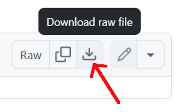
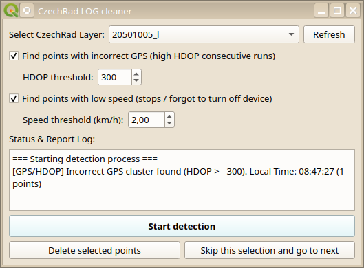

# QGIS-Plugins

Here you will find various plugins for the QGIS 3.x (did not tested it in QGIS4 yet). The plugins were created in good faith, primarily to make the work of users in the field of citizen radioactivity measurements more comfortable.

The functionality of the plugins was tested on QGIS 3.44 Solothurn (LTR release) on Windows and Kubuntu GNU/Linux.

## Installation:

Just download the ZIP file from here - click the provided link and then the Download raw file icon:

and unpack the file to the scripts subfolder in your QGIS user profile - the path is usually like this:

Windows: %APPDATA%\QGIS\QGIS3\profiles\default\python\plugins

Linux: ~/.local/share/QGIS/QGIS3/profiles/default/python/plugins

macOS: ~/Library/Application Support/QGIS/QGIS3/profiles/default/python/plugins

Or just go to the main QGIS menu toolbar and choose *Settings / User Profiles / Open Active Profile Folder* - the profile folder will open in the default file manager.

If you have QGIS running, close it and restart it. If you do not see a new icon in QGIS toolbar, then check the plugin manager.

## CzechRad cleaner

Interactive tool to clean Safecast / CzechRad log points (HDOP & low speed).

**Download:** [czechrad_cleaner.zip](https://github.com/juhele/QGIS-Plugins/blob/main/czechrad_cleaner.zip)

* Support for CzechRad / Safecast data imported using RadiationToolbox QGIS plugin
* Detecting data with "wrong GPS" - eg. high HDOP outliers
* Detecting low speed clusters (stops, user forgot to switch off the detector at home etc.)
* Implemented changes to avoid from crashing QGIS when no valid Safecast/CzechRad layer is selected
* Embedded default symbology (dose rate classes)
* Known bugs: current version still unable to delete the points - you need to use RadiationToolbox button for this task
